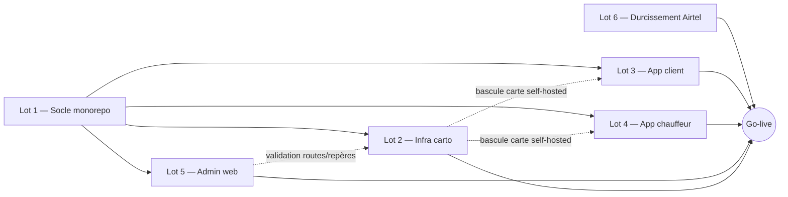

# Plan d'exécution — Teko (post-backend)

**Version :** 1.1 · **Date :** 18 août 2026 (v1.0 : 5 juin 2026) · **Périmètre :** MVP *ride-hailing*
**Stratégie validée :** pistes parallèles · hébergeur carto à trancher au lot 2 · région **Paris `eu-west-3`** (ADR-11)
**Nouveau depuis v1.0 :** la **phase maquettes UX est terminée** (69 maquettes des 3 interfaces + 4 spécifications de parcours, réalisées dans Claude Design — voir `../design/06-maquettes.md`). Les lots 3-5 démarrent donc avec des écrans et des flux spécifiés, pas depuis une page blanche. Le covoiturage est **sorti du périmètre MVP** (3 catégories).

Ce document transforme la liste des 6 prochaines étapes en **plan d'attaque exécutable** : phases, tâches, dépendances, critères d'acceptation et jalons. Il s'appuie sur l'architecture (`../architecture/`), le produit (`../product/`) et le backend déjà livré (`../../supabase/`).

---

## 1. État actuel (point de départ)

| Domaine | Statut |
|---|---|
| Documentation produit (`docs/product/`) | ✅ Livrée |
| Architecture + ADRs (`docs/architecture/`) | ✅ Livrée (ADR-01→11) |
| Schéma DB + RLS + fonctions métier (`supabase/migrations/`) | ✅ Livré, **56 tests pgTAP** |
| Edge Functions Airtel (`supabase/functions/`) | ✅ Livrées (3 TODO ouverts → lot 6) |
| Design system + icônes (`docs/design/`, `assets/`) | ✅ Livré |
| **Maquettes UX des 3 interfaces** (69 écrans + 4 specs de parcours, `../design/06-maquettes.md`) | ✅ Livrées (18 août 2026) — backlog UX v1.1 : 4 écrans (`02-backlog.md`) |
| **Monorepo frontend** (`apps/`, `packages/`) | ❌ À créer (lot 1) |
| **Infra carto self-hosted** (`infra/`) | ❌ À créer (lot 2) |
| **3 applications** (client, chauffeur, admin) — code | ❌ À créer (lots 3-5), sur la base des maquettes |

---

## 2. Principes directeurs

1. **Le socle débloque tout.** Le lot 1 (monorepo + packages partagés + types générés) est strictement bloquant ; rien d'autre ne démarre avant qu'il soit vert.
2. **Pistes parallèles ensuite.** Une fois le socle posé, l'**infra carto (Track B)** et les **apps (Track C)** avancent en parallèle.
3. **Carte sur repli managé d'abord.** Les apps affichent la carte via **tuiles managées de repli** (MapTiler/Stadia) tant que le self-hosted n'est pas prêt. Bascule plus tard par simple **changement d'URL de style MapLibre** (ADR-10). Les apps ne sont donc jamais bloquées par l'infra.
4. **Tranches verticales testables.** Chaque lot livre un incrément démontrable en staging, avec critères d'acceptation explicites.
5. **L'autorité reste au backend.** Les fonctions Postgres/Edge déjà livrées sont la source de vérité ; les apps les **consomment** (pas de logique métier sensible réimplémentée côté client). `packages/core` ne contient que des règles pures (estimations d'affichage).
6. **Tests à chaque étape.** pgTAP/Deno (déjà en place) + tests unitaires packages + e2e parcours critiques.

---

## 3. Graphe de dépendances

> Le lot 6 (Airtel) peut démarrer dès que l'app/admin déclenchent des paiements en staging ; il doit être **fini avant le go-live** (conditions réelles).

---

## 4. Phase 0 — Pré-requis & décisions (avant de coder)

À régler en parallèle du démarrage du lot 1 ; certains points conditionnent les lots suivants.

| # | Action | Bloque | Décision/critère |
|---|---|---|---|
| 0.1 | **Créer le projet Supabase de prod** en région **Paris `eu-west-3`** + un projet **staging** | Tous | ADR-11 actée |
| 0.2 | **Choisir l'hébergeur carto** (Scaleway / OVH / AWS `eu-west-3`) | Lot 2 | Critères : latence depuis Paris/Gabon, coût stockage objet + CDN, S3-compatibilité, facilité IaC |
| 0.3 | **Choisir le fournisseur SMS OTP** Gabon | Lot 3 (auth) | Coût/SMS, fiabilité, sender ID, intégration provider Supabase Auth |
| 0.4 | Comptes **Expo/EAS** (build cloud + OTA) | Lots 3-4 | Organisation, profils de build Android |
| 0.5 | Accès **sandbox Airtel Money** (client_id/secret, clé publique RSA) | Lot 6 | Déjà partiellement évalué (`docs/integrations/airtel-money-evaluation.md`) |
| 0.6 | Choisir les **tuiles managées de repli** (MapTiler ou Stadia) | Lots 3-4 | Clé API + style compatible MapLibre |

---

## 5. Track A — Socle monorepo (Lot 1) · *bloquant*

Objectif : un monorepo qui build, type-check et lint, avec les packages partagés et les 3 apps qui démarrent à vide. Conforme à `01-vue-ensemble.md`.

### Tâches

1. **Init Turborepo 2.7 + pnpm 10** (workspaces + **catalogs** pour figer les versions partagées). `turbo.json` (pipelines build/lint/test/typecheck), `.npmrc`, `pnpm-workspace.yaml`.
2. **`packages/config`** — `tsconfig` base (strict), ESLint, Prettier partagés. Premier package car tous en dépendent.
3. **`packages/types`** — **génération** depuis le schéma Supabase (`supabase gen types typescript`) ; script `pnpm gen:types` + commit. Source unique de vérité des DTO.
4. **`packages/api-client`** — client typé Supabase (auth OTP, RPC, Realtime, Storage) + wrappers d'appels (`requestRide`, `acceptRide`, `setCommission`, …) s'appuyant sur `types`.
5. **`packages/core`** — règles pures testables (estimation d'affichage, formatage XAF, business-day 04:00) ; tests unitaires.
6. **`packages/ui`** — composants partagés + **design tokens** importés depuis `docs/design/design-tokens.json` (palette violet→magenta, etc.).
7. **`packages/maps`** — abstraction carte MapLibre (rendu, style, repli managé ↔ self-hosted via URL, routing client). Pose l'interface, impl. minimale.
8. **`packages/i18n`** — socle i18n, français livré, structure prête pour langues locales (ADR-08).
9. **`packages/telemetry`** — mesure conso data + logging client (widget data, mode économie).
10. **`apps/client`** & **`apps/driver`** — scaffolds **Expo SDK 56** (New Arch, Hermes V1), navigation, écran d'accueil branché sur `api-client`.
11. **`apps/admin`** — scaffold **Next.js 16.2** (App Router), auth admin, layout.
12. **CI monorepo** — workflow GitHub : install pnpm, `turbo lint typecheck test build` ; cache. S'ajoute aux CI existantes (`db-ci`, `functions-ci`).

### Critères d'acceptation (M1)

- `pnpm install && pnpm turbo build lint typecheck test` **vert** en local et en CI.
- `pnpm gen:types` régénère `packages/types` sans diff inattendu.
- Les **3 apps démarrent** (client/driver via Expo, admin via `next dev`) et lisent une donnée réelle via `api-client` (ex. liste de catégories véhicules depuis Supabase).

---

## 6. Track B — Infra carto self-hosted (Lot 2) · parallèle après A

Objectif : servir le fond de carte + couches PostGIS et router/tarifer y compris sur les **routes ajoutées par Teko** (ADR-07/10). Détails dans `../architecture/06-infra-cartographie.md`.

### Tâches

1. **B0 — Trancher l'hébergeur** (cf. 0.2) et poser `infra/` (compose dev + IaC prod, blue/green).
2. **B1 — Pipeline tuiles** : extract **Gabon** (osmium + Geofabrik) → **Planetiler** → **PMTiles** → stockage objet + CDN.
3. **B2 — Serveur Martin** : sert le fond PMTiles **+ couches PostGIS** (`road_segments`, `landmarks` validés) → affichage **instantané** des routes/repères validés (pas de rebuild).
4. **B3 — Routing Valhalla** (`docker-valhalla`) + **map-matching Meili** pour les traces GPS chauffeurs.
5. **B4 — Job de reconstruction** Valhalla (nocturne + à la demande, **blue/green**) : une route validée par l'admin devient routable au prochain rebuild. Définir la **cadence**.
6. **B5 — Repli managé** : style MapLibre alternatif (MapTiler/Stadia) commutable par URL, pour la résilience.
7. **B6 — Conflation** : stratégie d'intégration des routes Teko dans l'extract OSM (identifiants stables, conflits amont).

### Critères d'acceptation (contribue à M2/M4)

- Une **route ajoutée puis validée** en admin (couche PostGIS) s'**affiche immédiatement** via Martin.
- Après rebuild, un **itinéraire de référence** emprunte cette nouvelle route (test de non-régression du routing dans la CI infra).
- Bascule repli ↔ self-hosted sans rebuild d'app (changement d'URL de style).

---

## 7. Track C — Applications (Lots 3, 4, 5) · parallèle après A

Carte sur **repli managé** au début ; bascule self-hosted quand B est prêt. Toutes les apps consomment les RPC backend déjà livrées.

### Lot 3 — App client (Expo)

Auth **OTP SMS** ; **carte MapLibre** ; **adressage par repères** (`nearest_landmarks`, `reverse_geocode_landmark`, `suggest_meeting_landmark`) ; **estimation prix** (`estimate_price`) ; **cycle de course** (`request_ride` → suivi Realtime → `complete_ride`) ; **paiement espèces + Airtel** ; **sécurité** (SOS, partage de trajet, **PIN** début de course) ; **widget conso data** + mode économie ; évaluation ; annulation (no-show/no-answer).

### Lot 4 — App chauffeur (Expo)

**KYC** (CNI/permis/carte grise/assurance/photo véhicule/**casier judiciaire**) via Storage privé `kyc` ; **réception/acceptation de courses** (`accept_ride`/`mark_arrived`/`start_ride(pin)`) ; **guidage par repères** (Edge `guidance`) ; **suivi du solde journalier** (`driver_balance`, échéance 04:00, réactivation) ; partage position Realtime ; widget data.

### Lot 5 — Admin web (Next.js)

**Validation routes/repères** (`validate_landmark_proposal`, pipeline routes) → alimente Track B ; **validation KYC** ; **paramétrage commission** via `set_commission`/`get_commission` (**réservé au superadmin**, déjà livré) + autres `app_config` ; **suivi des règlements/payouts** (ledger, `daily_statements`, `create_settlement_payment`) ; gestion des rôles/admins.

### Critères d'acceptation (M3)

- Parcours **bout-en-bout en staging** : client commande → chauffeur accepte → PIN → course → `complete_ride` → effet solde correct ; paiement **Airtel sandbox** confirmé via callback/réconciliation ; cas **cash** crée la dette de commission.
- Admin valide un repère et une route ; modifie la commission (superadmin) et la nouvelle valeur s'applique à la course suivante.

---

## 8. Lot 6 — Durcissement Airtel · avant go-live

Finaliser les TODO de `supabase/functions/_shared/payments/airtel.ts` : **chiffrement RSA du PIN**, **chemin d'enquiry** réel, **vérification de signature du callback**. Puis **tests en sandbox Airtel** (collect/disburse/enquire/callback + idempotence), avant tout passage en conditions réelles.

**Acceptation (M4)** : transactions sandbox de bout en bout vertes ; signature de callback rejetée si invalide ; pas de double-crédit (idempotence par `partner_txn_id`).

---

## 9. Jalons

| Jalon | Contenu | Dépend de |
|---|---|---|
| **M1 — Socle vert** | Monorepo build/lint/typecheck/test OK, types générés, 3 apps démarrent | Lot 1 |
| **M2 — Carte visible** | Infra carto en staging (route validée routée) **et** apps affichant la carte (repli) | A + début B + début C |
| **M3 — Parcours e2e** | Course complète client+chauffeur+admin en staging, Airtel sandbox | Lots 3-5 |
| **M4 — Durci & basculé** | Bascule carte self-hosted + Airtel durci | Lots 2, 6 |
| **M5 — Bêta Android** | Build EAS, OTA, distribution restreinte | Tous |

---

## 10. Risques & mitigations

| Risque | Impact | Mitigation |
|---|---|---|
| Retard infra carto self-hosted | Apps sans carte définitive | **Repli managé** dès le départ ; bascule par URL (ADR-10) |
| Compat **MapLibre RN** avec Expo SDK 56 New Arch | Bloque la carte mobile | **Vérifier tôt** (spike au lot 1, package `maps`) ; plan B : dev client ou build natif |
| Délivrabilité **SMS OTP** au Gabon | Auth dégradée | Choisir provider fiable (0.3) ; fallback email optionnel déjà prévu |
| Latence Paris ↔ Gabon | UX dégradée | Mesurer en staging ; CDN pour tuiles ; Realtime léger (sobriété data) |
| Onboarding **Airtel** (accès, RSA) | Bloque paiement mobile | Provider mock déjà en place ; démarrer 0.5 tôt ; cash dispo au MVP |

---

## 11. Suivi & décisions ouvertes

- **À trancher au démarrage** : hébergeur carto (0.2), provider SMS (0.3), tuiles de repli (0.6), cadence de rebuild Valhalla (B4).
- **Déjà tranché** : région Paris `eu-west-3` (ADR-11), commission superadmin-only, Android d'abord (ADR-09) ; et depuis le 18 août 2026 (phase UX) : construction neuve (pas le template Taxido), 3 catégories sans covoiturage, e-mail OTP de secours MVP, frais d'annulation flexibles admin, rôles admin séparés dès le départ — liste complète dans `../product/05-questions-ouvertes.md`.
- **Registre des risques** : `01-registre-risques.md`. **Backlog produit** : `02-backlog.md`.
- Le suivi d'avancement se fait via ce document (mis à jour à chaque jalon).
